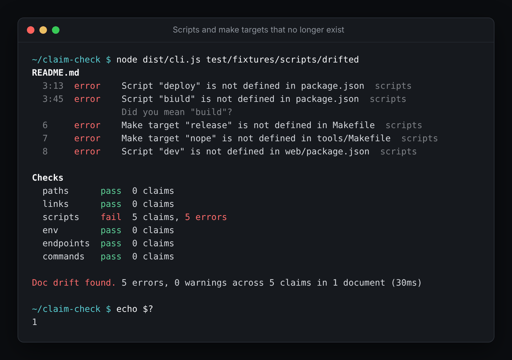
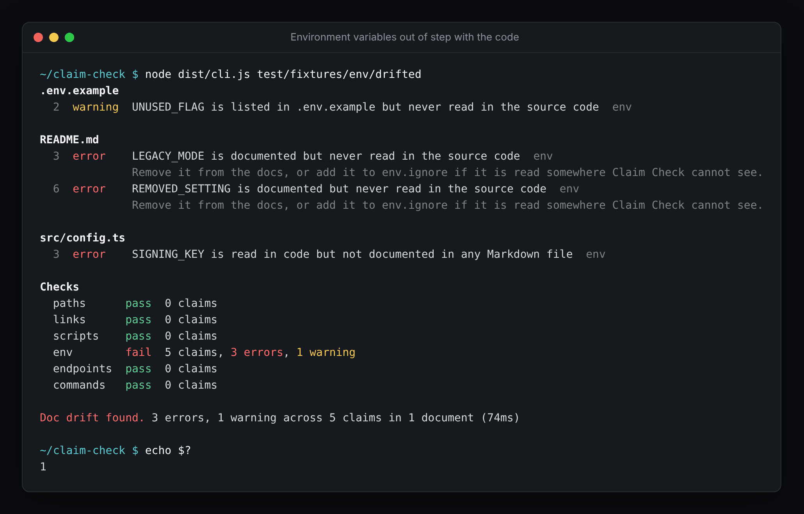
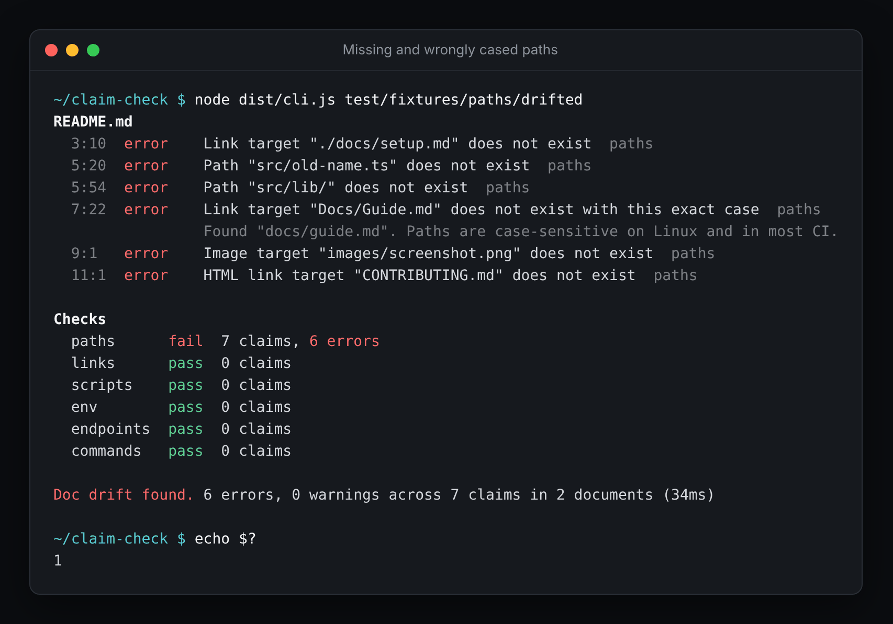
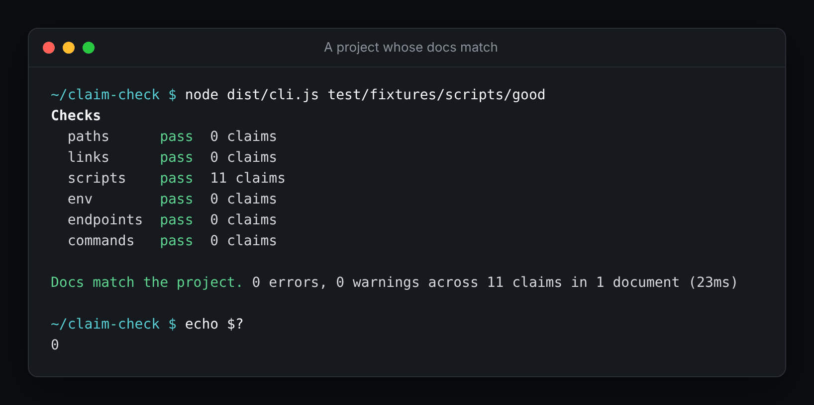
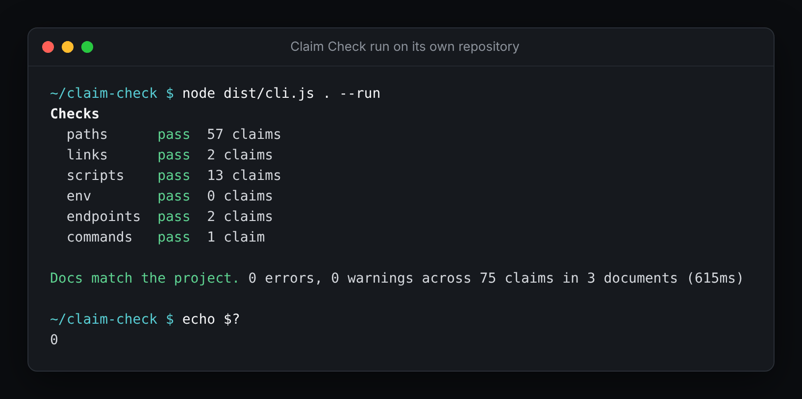

# Claim Check

[](https://github.com/banjonay1992/claim-check/actions/workflows/ci.yml)
[](LICENSE)

Claim Check tests whether a project's README and other Markdown docs are still telling the truth.

Docs make claims about the code around them. This file lives here. Run this script to build. Set this environment variable before starting. This endpoint returns a user. Every one of those claims can quietly stop being true when the code changes and nobody remembers to update the docs. Claim Check reads the claims, checks each one against the project, and reports "doc drift" the way a test suite reports failures: with a file, a line number, a reason and a non-zero exit code.

**Status:** version 0.1.0, the first release. It runs on every push in this repository's own CI, where it checks this README, the roadmap and the contributing guide (runnable blocks included), and it ships as a GitHub Action. It is not on npm yet. The [roadmap](ROADMAP.md) and the [issues](https://github.com/banjonay1992/claim-check/issues) show what comes next.



The screenshots in this README are real runs of the command-line tool against the sample projects in `test/fixtures/` and against this repository.

## Quick start

Claim Check needs Node.js 22.12 or newer. It is not published to npm yet, so for now run it from a clone of this repository:

```sh
git clone https://github.com/banjonay1992/claim-check.git
cd claim-check
npm ci
npm run build
node dist/cli.js path/to/your/project
```

To see it find drift straight away, point it at one of the sample projects:

```sh
node dist/cli.js test/fixtures/env/drifted
```

Running `npm link` in the clone puts a `claim-check` command on your path. Once a release is published, `npm install --save-dev claim-check` will do the same per project. To run it in GitHub Actions, see [Using it in CI](#using-it-in-ci).

## Who it is for

It is for people who maintain a project with a README that other people rely on: open-source maintainers, small teams, and solo developers who want CI to catch a stale README before a new contributor does. It is a command-line tool that runs locally or in any CI system, and it needs nothing beyond Node.js.

## What it checks

| Check | What it verifies |
| --- | --- |
| `paths` | Files and directories referenced by links, images and inline code exist, with the exact case. |
| `links` | Heading anchors in relative links resolve, in the same file or another Markdown file. External URLs are checked only when you ask. |
| `scripts` | Scripts for `npm`, `pnpm`, `yarn` and `bun`, and Makefile targets, that the docs tell people to run are defined. |
| `env` | Environment variables read in code or listed in an example env file are documented, and documented ones are still used. |
| `endpoints` | HTTP routes documented as a method and path are defined somewhere in the source. |
| `commands` | Shell blocks you mark as runnable exit with the expected code. These are only listed unless you pass `--run`. |

<details>
<summary>More screenshots</summary>

Environment variables that are documented but no longer read, or read but never documented:



Missing files, a wrongly cased link and a missing image:



A project whose docs match:



</details>

## Built with

- TypeScript on Node.js 22 or newer, compiled with `tsc`
- [mdast-util-from-markdown](https://github.com/syntax-tree/mdast-util-from-markdown) with the GFM and front matter extensions, for a positioned Markdown syntax tree
- [github-slugger](https://github.com/Flet/github-slugger), so heading anchors match the ones GitHub generates
- [picomatch](https://github.com/micromatch/picomatch) for glob patterns in the config
- [Vitest](https://vitest.dev) for the test suite

There are no other runtime dependencies. Claim Check does not touch the network unless you pass `--external`.

## Usage

```text
claim-check [dir] [options]
```

The directory defaults to the current one. Useful options:

| Option | Meaning |
| --- | --- |
| `-c, --config <file>` | Use this config file instead of looking for one in the project. |
| `--only <checks>` | Run only these checks, for example `--only paths,links`. |
| `--skip <checks>` | Skip these checks. |
| `--run` | Execute shell blocks marked as runnable. |
| `--external` | Also check external http and https links. |
| `-f, --format <name>` | Report format: `human` (the default), `json`, `junit` or `sarif`. |
| `--json` | Shorthand for `--format json`. |
| `-o, --output <file>` | Write the report to a file instead of standard output. |
| `--fail-on <level>` | Fail on `error` (the default) or on `warning` too. |
| `-q, --quiet` | Show only errors in the human report. |
| `--no-color` | Turn off coloured output. Setting `NO_COLOR` does the same, and `FORCE_COLOR` turns colour on when output is not a terminal. |
| `--list-checks` | List the checks and exit. |

The exit code is 0 when the docs match the project, 1 when drift was found, and 2 for a usage or configuration problem (an unknown option, a broken config file, or a directory with no Markdown files).

Here is the human report for `test/fixtures/scripts/drifted`, a sample project whose README has fallen behind its `package.json` and Makefiles:

```text
README.md
  3:13  error    Script "deploy" is not defined in package.json  scripts
  3:45  error    Script "biuld" is not defined in package.json  scripts
                 Did you mean "build"?
  6     error    Make target "release" is not defined in Makefile  scripts
  7     error    Make target "nope" is not defined in tools/Makefile  scripts
  8     error    Script "dev" is not defined in web/package.json  scripts

Checks
  paths      pass  0 claims
  links      pass  0 claims
  scripts    fail  5 claims, 5 errors
  env        pass  0 claims
  endpoints  pass  0 claims
  commands   pass  0 claims

Doc drift found. 5 errors, 0 warnings across 5 claims in 1 document (28ms)
```

By default every `.md` and `.markdown` file in the project is checked, except anything under `node_modules`, `.git`, common build output folders (such as `dist`, `build` and `coverage`) and changelogs, which describe history rather than the present.

## The checks in detail

### Paths

Every relative link target, image source and HTML `href` or `src` attribute must exist. Targets are resolved from the folder of the document, and a leading slash means the project root, as it does on GitHub.

<!-- claim-check-ignore-start paths -->
Inline code is treated as a path claim when it clearly looks like one: an explicit relative path such as `./scripts/setup.sh`, a folder with a trailing slash such as `src/`, a multi-part path ending in a known file name such as `src/index.ts`, or a single well-known file name such as `package.json` or `Makefile`. Inline paths may be written relative to the document or to the project root. Anything that merely looks a bit like a path is left alone, such as `owner/repo`, `Node.js`, `node:fs` or `/api/users`. Paths under folders that are normally generated or installed (`dist/`, `build/`, `node_modules/` and similar) and local env files such as `.env` are skipped, because a reader creates those.
<!-- claim-check-ignore-end -->

Existence is checked with the exact case. A link to `Docs/Guide.md` that works on a case-insensitive Mac would break on Linux CI, so Claim Check reports it with the real spelling as a hint. <!-- claim-check-ignore-line paths -->

### Links

For links with a fragment, the anchor must exist in the target document. Anchors come from headings, using the same slugs GitHub generates (including the `-1` suffix for repeated headings), and from HTML `id` and `name` attributes. Links to `#top` are always accepted. When an anchor is missing and a heading is close, the report suggests it.

External links are only checked with `--external` (or `links.external` in the config). Each URL is requested with `HEAD`, falling back to `GET` for servers that reject `HEAD`, with a timeout and a concurrency limit. A 404 or 410 is an error. A timeout, a 429 or a server error is a warning, because it may not be the docs' fault. Hosts such as `localhost` and the reserved example domains are never fetched. Definite answers are cached for 24 hours in `.claim-check-cache.json` in the project root, which you will probably want to add to your `.gitignore`. <!-- claim-check-ignore-line paths -->

### Scripts

Commands such as `npm run build`, `npm test`, `pnpm run dev`, `yarn lint` and `bun run seed` are looked up in the nearest `package.json` above the document. `make build` is looked up in the nearest Makefile, following `include` lines and pattern rules. Directory flags (`--prefix`, `--dir`, `--cwd`, and `-C` for make) are understood. Commands are found in inline code, in shell code blocks and, for the npm family, in plain prose. Built-in package manager commands such as `yarn add` are not mistaken for scripts. Workspace runs (`-w`, `--filter`) and `--if-present` runs are skipped for now. <!-- claim-check-ignore-line scripts -->

### Environment variables

Claim Check finds variables read in source code in JavaScript and TypeScript (`process.env`, `import.meta.env`, `Deno.env.get`, `Bun.env`), Python, Ruby, Go, Rust, Swift, PHP, Java, Kotlin, C#, Elixir and Dart, and variables listed in example env files. It then compares them with the variables the docs mention: in inline code, in shell and dotenv code blocks, and in prose.

<!-- claim-check-ignore-start env, paths -->
- A variable that is read in code but not mentioned in any document is undocumented, and an error by default. For example, code that reads `process.env.DATABASE_URL` needs `DATABASE_URL` to appear somewhere in the docs.
- A variable that is clearly documented (for example in inline code like `SESSION_SECRET` or `PORT=3000`, or in a shell block) but appears nowhere in the source is stale, and also an error by default.
- A variable in `.env.example` that nothing reads is reported as a warning.
<!-- claim-check-ignore-end -->

Stale checks only run when Claim Check found at least one variable read in the source, so a project whose code it cannot read is not flooded with false alarms. Common system variables such as `PATH`, `HOME` and `NODE_ENV` are ignored by default.

### Endpoints

<!-- claim-check-ignore-start endpoints -->
Claims such as `GET /api/users/:id` in inline code, prose or code blocks are matched against routes defined in the source. Express style routers (including Koa, Fastify, Hono and Gin), Flask, FastAPI, Spring, Go `net/http` (including Go 1.22 method patterns), ASP.NET minimal APIs, Rails and Sinatra are recognised, along with file-system routes in Next.js and SvelteKit. Parameter styles are treated as equal, so `/users/{id}`, `/users/:id`, `/users/<int:id>` and `/users/[id]` all match, and a concrete path such as `/users/42` matches a parameterised route. Mount prefixes such as `app.use('/api', router)` or a FastAPI router prefix are tried automatically, and you can add more in the config.
<!-- claim-check-ignore-end -->

If the docs name a path that exists but with a different method, that is reported too. When no route definitions are found at all, the check is skipped, since the docs probably describe a service that lives elsewhere.

### Commands

Commands are the only check that runs anything, so they are opt-in twice over. A shell block is runnable only if you mark it, and marked blocks are only listed unless you pass `--run`.

Mark a block with `claim-check:run` in its info string, or with a directive comment straight above it:

````markdown
```sh claim-check:run
npm ci
npm test
```

<!-- claim-check:run timeout=2m exit=0 cwd=examples -->
```bash
./run-example.sh
```
````

The options are `timeout` (such as `500ms`, `30s` or `2m`, default 60 seconds), `exit` (the expected exit code, default 0) and `cwd` (a folder relative to the project root). In `console` blocks, only lines starting with `$ ` are run, and the rest is treated as sample output.

With `--run`, the project is copied to a temporary folder (leaving out `.git`, and linking `node_modules` rather than copying it) and the blocks run there, in document order, with `bash -e -o pipefail`. They also get `CLAIM_CHECK=1` in their environment. Each block has its own timeout, and a block that runs over is stopped along with anything it started. You can run in the project itself, or in another folder, with the `commands.workdir` setting. Running commands from docs runs real code on your machine, so only use `--run` on projects you trust.

This README has one runnable block, which the CI for this repository executes:

```sh claim-check:run timeout=30s
node dist/cli.js --version
```

### Ignoring things

You can switch checks off for part of a document with HTML comments, which do not show up when the Markdown is rendered:

````markdown
<!-- claim-check-ignore -->
This paragraph (the next block) is not checked at all.

This line is not checked for paths. <!-- claim-check-ignore-line paths -->

<!-- claim-check-ignore-start env, endpoints -->
Everything in here is skipped by the env and endpoints checks.
<!-- claim-check-ignore-end -->
````

Without a list of checks, a directive applies to every check. This README uses them for its own examples.

## Configuration

<!-- claim-check-ignore-start paths -->
Claim Check looks for `claimcheck.config.json` or `.claimcheck.json` in the project root, or uses the file given with `--config`. Every setting is optional. Here is a config that sets most of them:
<!-- claim-check-ignore-end -->

<!-- claim-check-ignore endpoints -->
```json
{
  "docs": ["README.md", "docs/**/*.md"],
  "ignore": ["test/fixtures", "legacy/**"],
  "source": ["src/**", "server/**"],
  "skip": ["endpoints"],
  "failOn": "error",
  "paths": { "ignore": ["generated/**"], "inlineCode": true },
  "links": {
    "external": false,
    "timeoutMs": 5000,
    "concurrency": 8,
    "ignore": ["https://internal.example.org/**"],
    "cacheFile": ".claim-check-cache.json",
    "cacheTtlHours": 24
  },
  "commands": { "timeoutMs": 60000, "shell": "bash", "workdir": "copy", "env": { "LOG_LEVEL": "warn" } },
  "env": { "ignore": ["VITE_*"], "undocumented": "error", "stale": "warning", "unusedExample": "off" },
  "scripts": { "ignore": ["release"] },
  "endpoints": { "prefixes": ["/v1"], "ignore": ["GET /internal/*"] }
}
```

| Setting | Default | Meaning |
| --- | --- | --- |
| `docs` | all Markdown files | Globs for the documents to check. |
| `ignore` | none | Globs ignored everywhere, for both documents and source. Build folders and changelogs are always ignored. |
| `source` | everything | Globs for the source files scanned by the env and endpoints checks. |
| `only`, `skip` | all checks | Which checks run. `--only` replaces `only`, and `--skip` adds to `skip`. |
| `failOn` | `error` | Set to `warning` to fail on warnings too. |
| `paths.ignore` | none | Claimed paths to leave alone. |
| `paths.inlineCode` | `true` | Treat inline code that looks like a path as a claim. |
| `links.*` | see above | External link checking. `skipHosts` lists hosts that are never fetched. |
| `commands.*` | see above | `workdir` is `copy`, `inplace` or a folder. `copyExclude` and `linkNodeModules` control the temporary copy. |
| `env.ignore` | system variables | Variable names or globs to ignore. |
| `env.undocumented`, `env.stale`, `env.unusedExample` | `error`, `error`, `warning` | Severity for each kind of finding, or `off`. |
| `env.exampleFiles` | the usual example env file names | Example env file names to read. |
| `scripts.ignore` | none | Script or target names to ignore. |
| `endpoints.prefixes` | none | Extra mount prefixes to try. |
| `endpoints.ignore` | none | Routes to ignore, as `METHOD /path` or `/path` globs. |

Unknown settings and wrong types are rejected with a message that names the setting, so a typo in the config does not silently switch something off.

## Using it in CI

Claim Check exits with 1 when it finds drift, so adding it as a step is enough to fail a build.

### With the GitHub Action

This repository is also a composite GitHub Action. It builds Claim Check, prints the report to the log, marks each error and warning as an annotation on the file and line, writes a short table to the job summary page and writes a SARIF file:

```yaml
name: Docs
on: [push, pull_request]

permissions:
  contents: read

jobs:
  claim-check:
    runs-on: ubuntu-latest
    steps:
      - uses: actions/checkout@v5
      - uses: banjonay1992/claim-check@v0
```

The `v0` tag follows the latest 0.x release. The repository is private for now, so other repositories can only use the action once it is public.

| Input | Default | Meaning |
| --- | --- | --- |
| `path` | `.` | Project folder to check. |
| `args` | none | Extra options separated by spaces, such as `--run --only paths,links`. The action sets the report format itself. |
| `sarif` | `claim-check.sarif` | Where to write the SARIF report. An empty string skips it. |
| `annotations` | `true` | Annotate errors and warnings on the files they belong to. |
| `summary` | `true` | Write a table of results to the job summary page. |
| `fail` | `true` | Fail the step when drift is found. |
| `node-version` | `22` | Node.js version to set up. An empty string uses the runner's own Node.js. |

The outputs are `exit-code`, `errors`, `warnings` and `sarif-file`. To see findings in GitHub code scanning, add `security-events: write` to the permissions and upload the SARIF file after the action:

```yaml
      - uses: banjonay1992/claim-check@v0
        with:
          fail: false
      - uses: github/codeql-action/upload-sarif@v3
        with:
          sarif_file: claim-check.sarif
```

### With plain steps

Once Claim Check is on npm, any CI system can run it with `npx`. This GitHub Actions workflow does the same as the action with plain steps, and uploads a SARIF report for code scanning:

```yaml
name: Docs
on: [push, pull_request]

permissions:
  contents: read
  security-events: write

jobs:
  claim-check:
    runs-on: ubuntu-latest
    defaults:
      run:
        shell: bash
    steps:
      - uses: actions/checkout@v5
      - uses: actions/setup-node@v5
        with:
          node-version: 22
      - run: npm ci
      - run: npx claim-check --format sarif --output claim-check.sarif
      - if: always()
        uses: github/codeql-action/upload-sarif@v3
        with:
          sarif_file: claim-check.sarif
```

If your CI shows test reports, `--format junit` produces one test suite per check. Plain `npx claim-check` in a step prints the human report to the log.

### Claim Check on its own repository

This repository is the first project Claim Check is used on. On every push and pull request, [CI](.github/workflows/ci.yml) does three things with it:

- `npm run self-check -- --run` builds the tool and checks this README, the roadmap and the contributing guide on Node.js 22 and 24, including the runnable block in the [Commands](#commands) section. A broken link or a renamed script fails the build.
- It uploads the same check as a JUnit report.
- It runs the GitHub Action on this repository, and on the drifted scripts sample to prove the action reports drift.



## Programmatic use

The CLI is a thin layer over a small API:

```ts
import { runClaimCheck, formatReport } from 'claim-check';

const result = await runClaimCheck({ root: '.', only: ['paths', 'links'] });
console.log(formatReport(result, 'human'));
process.exitCode = result.summary.passed ? 0 : 1;
```

## Limitations

- Claims are found with heuristics, not by understanding the prose. A bare file name in inline code that the reader is meant to create, such as a new config file, will be reported as missing. Use an ignore directive or `paths.ignore` for those.
- Paths inside fenced code blocks are not checked, only inline code and links.
- Environment variable reads are found by pattern. Variables read through a config library, a loop over a list of names or a schema in another format are not seen, which can make them look undocumented or stale.
- Route matching is also pattern based. HTTP client calls that look like route definitions, such as `axios.get('/api/x')`, count as routes, and routes built from variables are missed.
- Commands run with `bash` and are not supported on Windows yet. The temporary copy is a plain copy, not a container, so a command can still reach the network and anything else your user account can.
- Workspace-aware script checks (`npm -w`, `pnpm --filter`, `yarn workspace`) are not implemented yet.
- Only Markdown is supported. MDX files are not parsed, and reStructuredText and AsciiDoc are out of scope for now.

The [roadmap](ROADMAP.md) lists what is planned next.

## Contributing

Bug reports and pull requests are welcome. See [CONTRIBUTING.md](CONTRIBUTING.md) for how to set up the project and add a check, and [CHANGELOG.md](CHANGELOG.md) for what has changed.

## Licence

MIT. See [LICENSE](LICENSE).
